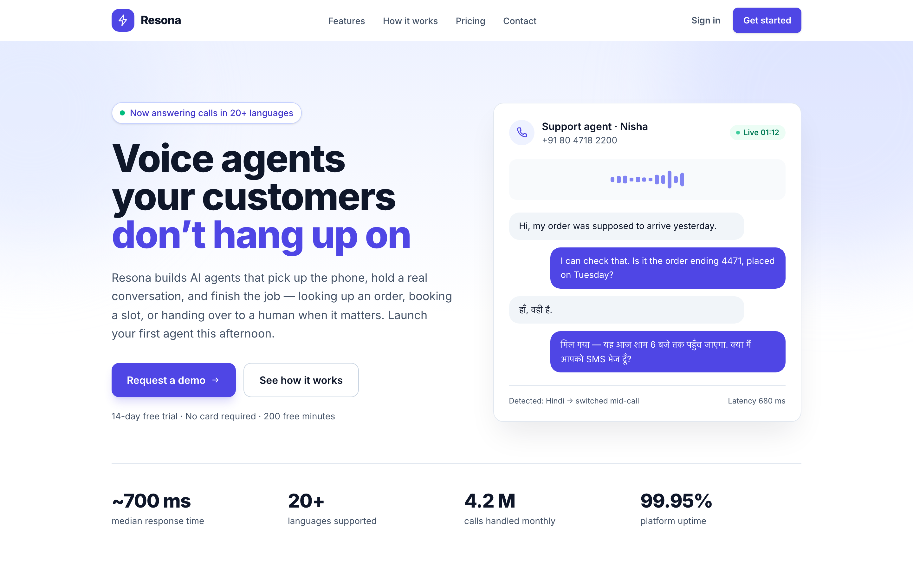
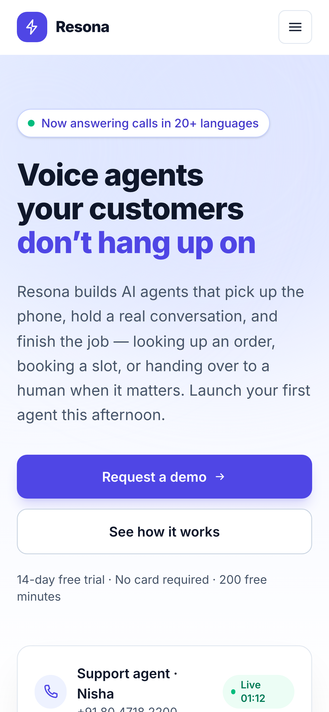
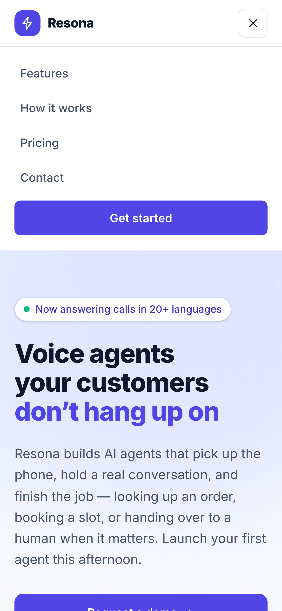

# Resona — SaaS landing page

A responsive marketing site for a fictional AI voice-agent platform, built for the
**Sankar Group front-end development internship assignment**.

**Live site:** _add the deployed URL here_



---

## Running it locally

Requires Node 20 or newer.

```bash
npm install
npm run dev      # http://localhost:5173
```

Other scripts:

```bash
npm run build    # type-check, then build to dist/
npm run preview  # serve the production build locally
npm run lint     # oxlint
```

## Tech stack

| Choice | Why |
| --- | --- |
| **React 19 + TypeScript** | The page has real state — mobile menu, pricing toggle, form validation. Typed props keep the content model and the components honest about each other. |
| **Vite** | Instant dev server, and `npm run build` type-checks before it bundles, so a bad prop never reaches `dist/`. |
| **Tailwind CSS v4** | Spacing, type and colour come from one scale, which is most of what "visual consistency" means in practice. Brand tokens are declared once in `src/index.css` under `@theme`. |
| **No UI kit** | Six section types didn't justify pulling in a component library. Everything here is hand-written, so there is no vendor styling to fight. |

## Project structure

```
src/
├── App.tsx                  # section order — reads as a table of contents
├── index.css                # design tokens (@theme), base styles, keyframes
├── components/
│   ├── Navbar.tsx           # sticky header, scroll-spy, mobile menu
│   ├── Hero.tsx             # headline, CTAs, stat row
│   ├── CallCard.tsx         # the hero illustration, built in CSS
│   ├── Features.tsx         # six feature cards
│   ├── HowItWorks.tsx       # three-step timeline + use cases
│   ├── Pricing.tsx          # three plans, monthly/yearly toggle
│   ├── DemoForm.tsx         # contact section + validated demo form
│   ├── Footer.tsx
│   ├── Container.tsx        # the one max-width + gutter rule
│   ├── SectionHeading.tsx   # eyebrow / title / description
│   ├── Field.tsx            # label + control + error, with ARIA wiring
│   └── Icon.tsx             # inline SVG registry
├── data/content.ts          # every string on the page
├── hooks/useScrollSpy.ts    # IntersectionObserver → active section id
└── lib/validateDemoForm.ts  # pure validation rules
```

Three rules hold it together:

1. **Content is data.** All copy lives in `src/data/content.ts`. Components map over it.
   The nav links, the scroll-spy hook and the footer all derive from the same
   `NAV_LINKS` array, so a section can't fall out of sync with its link.
2. **Layout primitives, not per-section CSS.** `Container` owns the max width and the
   responsive gutters; `SectionHeading` owns the heading rhythm. No section invents its
   own spacing.
3. **Logic out of components.** Validation is a pure function in `src/lib/`, and the
   scroll-spy is a hook. `DemoForm` deals with state and markup, not rules.

## What's interactive

- **Navigation** — anchor links with CSS `scroll-behavior: smooth` and `scroll-padding-top`,
  so headings clear the sticky header. An `IntersectionObserver` highlights the link for
  whichever section is in view.
- **Mobile menu** — hamburger toggle under `md`, closes on link tap and when the viewport
  grows past the breakpoint.
- **Pricing toggle** — switches monthly/yearly; the yearly figure is derived from the
  monthly one (pay for ten months), and non-numeric prices like "Custom" pass through.
- **Demo form** — validates on submit, clears each field's error as you fix it, focuses
  the first invalid control, shows a pending state, then replaces itself with a success
  message that quotes your name and email back. No backend, as specified.

## Responsive behaviour

Built mobile-first and checked at 390 px, 768 px, 1024 px and 1440 px.

- Hero is a single column until `lg`, where it becomes text + illustration side by side.
- Features go 1 → 2 → 3 columns; pricing 1 → 3, with the highlighted plan lifted only on `lg`.
- The hero illustration is markup and CSS, not an image, so it reflows and stays sharp.

| Mobile | Mobile menu |
| --- | --- |
|  |  |

## Accessibility

Not on the brief, but most of it is free if you do it as you go: a skip link, one `<h1>`,
landmark elements, `aria-expanded`/`aria-controls` on the menu toggle, `role="switch"` on
the pricing toggle, `aria-invalid` + `aria-describedby` on invalid fields, an `aria-live`
region for the success message, visible focus rings, and a `prefers-reduced-motion` block
that turns off the animations.

## Design notes and trade-offs

The page sells a voice product, so the hero illustration is a mock live call rather than a
stock image — it shows a transcript switching from English to Hindi mid-call, which is the
one feature worth leading with. Building it in markup instead of an image keeps it sharp at
any size, lets it reflow on mobile, and adds nothing to the page weight.

Content is deliberately specific — real-sounding latency numbers, rupee pricing, named use
cases — because generic filler copy makes a landing page impossible to judge for hierarchy.
A single indigo accent carries every call to action; everything else is slate, so the eye
always knows where the next click is.

The main trade-off was React for a page with no routing and no data fetching. Plain HTML
would have shipped a smaller bundle, but the three interactive pieces are genuinely
stateful, and splitting content away from markup kept each component short enough to read
in one screen. The other trade-off is that the form has no backend: it validates fully and
simulates a 700 ms round trip, so the pending and success states are real UI states rather
than an instant flip, but nothing is actually sent.

---

Built by Ayush Nautiyal. Content and pricing are fictional.
